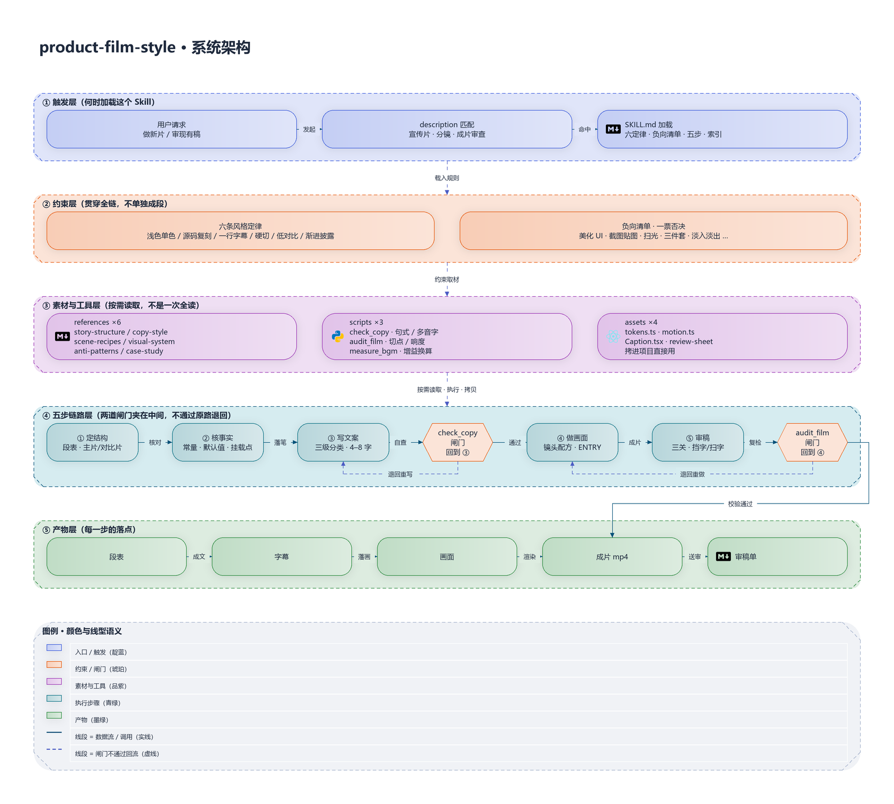

<h1 align="center">product-film-style</h1>

<p align="center"><sub>现代 indie SaaS 产品宣传片 · 风格规范 / 镜头配方 / 审稿工具</sub></p>

<p align="center">
  
  
  
  
  
  
</p>

<p align="center">
  白底、一个品牌色、真实界面自己说话，文字只当脚注。<br/>
  做片子照着它走，审片子照着它挑。
</p>

---

## 目录

- [这是什么](#这是什么)
- [六条风格定律](#六条风格定律)
- [负向清单（一票否决）](#负向清单一票否决)
- [架构](#架构)
- [目录结构](#目录结构)
- [安装](#安装)
- [快速上手](#快速上手)
- [命令行工具](#命令行工具)
- [开箱件：assets](#开箱件assets)
- [配置：tokens.ts](#配置tokensts)
- [参考文档](#参考文档)
- [实战验证](#实战验证)
- [两个容易走偏的地方](#两个容易走偏的地方)
- [贡献](#贡献)
- [许可证](#许可证)

---

## 这是什么

这套风格写给开发者与效率工具用户。他们对推销极度敏感，对看得见的真实细节买账，所以全片的气质是克制、准确、信息密度高但不拥挤，而不是热闹。

三根支柱，缺一根就散架：

1. **画面是程序化复刻的真实产品界面**——不是截图、不是示意图、不是「卡片里排一列键值对」
2. **信息渐进式披露**——同一时刻画面只承担一件事，下一件事等上一件事说完
3. **文字极简到近乎吝啬**——一行短语就是全部字幕，不给要点、不给四宫格、不给进度条

装成 Agent Skill 之后，它管两件事：

| 场景 | 输出 |
|---|---|
| 制作新片 | 段表 → 事实核对 → 字幕 → 画面实现 → 三关审稿 |
| 审查已有稿件 / 成片 | 「违反了哪条定律 + 负向清单命中项 + 具体改法」，有 mp4 先跑脚本用数据说话 |

## 六条风格定律

违反任意一条，就已经不是这个风格了，改细节救不回来。

| # | 定律 | 一句话判据 |
|---|---|---|
| 1 | 浅色底 + 单一品牌色 | 画面里的颜色只有两种用途：强调与语义。为好看而加的颜色一律删 |
| 2 | UI 必须源码真实界面的复刻 | 尺寸、行高、圆点直径、面板段顺序，都能在源码里指出来 |
| 3 | 画面负责说，文字只留一行 | 每段一行 4–8 字名词短语；其余全是必须在画面上出现的标识 |
| 4 | 硬切，不做花哨转场 | 没有 wipe / slide / 缩放穿越；切点那一帧必须已经有内容 |
| 5 | 低对比度、留白优先 | 阴影大范围低透明度、带紫不带黑；宁可留空不填装饰 |
| 6 | 渐进式披露 | 想讲三件事就排三个节拍；先完整后收窄，不是两版并排各说各话 |

## 负向清单（一票否决）

看到任何一条直接判不合格，不讨论程度：

- ~~重新设计、美化、改版产品 UI~~
- ~~用截图或设计稿贴图代替程序化绘制~~
- ~~高饱和对比色、闪烁动画、来回移动的 spotlight / highlight 扫光~~
- ~~每段都加「分段标题 + 副标题 + 要点列表」三件套~~
- ~~底部四宫格、特性九宫格、进度条、章节编号大字~~
- ~~字幕逐段淡入淡出~~
- ~~「不是……而是……」「不仅仅是……更是……」「让我们一起……」这类排比与空转开场~~
- ~~面向初学者堆术语，或反过来把专业观众当小白解释常识~~
- ~~配音稿有多音字未规避~~

## 架构

<p align="center">
  
</p>

五层结构：**触发展**（何时加载）→ **约束层**（六条定律 + 负向清单，贯穿全片）→ **素材与工具层**（references / scripts / assets，按需取用）→ **五步铺路层**（两道闸门夹在中间）→ **产物层**（段表 / 字幕 / 画面 / mp4 / 审稿单）。

两道闸门不通过就打回：`check_copy.py` 不过回第 3 步改文案，`audit_film.py` 不过回第 4 步重做画面。

## 目录结构

```
product-film-style/
├── SKILL.md              # 入口：风格定义 + 五步工作流 + 资源索引（154 行）
├── references/           # 六个按需读的参考文档
│   ├── visual-system.md  #   落地数值：安全区、色板、字号、阴影、动效、时间基准
│   ├── copy-style.md     #   文案三级分类、禁用句式、去 AI 味、多音字规避
│   ├── story-structure.md#   主片 / 对比片两套段表骨架
│   ├── scene-recipes.md  #   九种镜头配方（构图 / 时序 / 易错点）
│   ├── anti-patterns.md  #   22 条真实踩坑：现象 → 原因 → 正解
│   └── case-study.md     #   唯一完整落地案例的段表与实测数字
├── scripts/              # 三个可执行脚本（不需要读进上下文）
│   ├── check_copy.py     #   字幕静态检查
│   ├── audit_film.py     #   成片审稿：规格 / 切点空帧 / 响度
│   └── measure_bgm.py    #   换曲响度换算
├── assets/               # 四个直接拷进项目的实现件
│   ├── tokens.ts         #   设计 token
│   ├── motion.ts         #   动效原语
│   ├── Caption.tsx       #   字幕带 / 注释 / 落版地址
│   └── review-sheet.md   #   审稿单模板
├── skill.drawio          # 架构图源文件
└── skill.png             # 架构图
```

## 安装

### 前置要求

| 依赖 | 版本 | 用途 |
|---|---|---|
| Agent 客户端 | 支持 `SKILL.md` 的任意客户端 | Skill 加载 |
| Python | 3.9+ | 三个审稿脚本 |
| ffmpeg / ffprobe | 在 PATH 中 | 抽帧、响度测量 |
| numpy + Pillow | — | `audit_film.py` 帧密度分析 |
| React + Remotion | — | 仅做画面时需要，脚本不依赖 |

### 步骤

```bash
# 1. 取到本地（也可直接下载 zip）
git clone https://github.com/AlicDanclic/product-film-style.git

# 2. 放进 Agent 的 skills 目录（二选一，按你使用的客户端）
#    WorkBuddy
cp -r product-film-style ~/.workbuddy/skills/product-film-style
#    Claude Code
cp -r product-film-style ~/.claude/skills/product-film-style

# 3. 装脚本依赖
python -m pip install numpy pillow
```

确认 `SKILL.md` 的 frontmatter 能被识别就行。`name` 与 `description` 里写好了触发条件（做宣传片 / 审片 / 判断是否偏离风格）。

## 快速上手

### 写法一：让 Agent 直接做

装好之后直接提需求，skill 会按五步自己走：

> 用 product-film-style 给 PaperAgent 做一支 100 秒主片，先出段表给我看。

### 写法二：自己按五步走

**第 1 步 · 定结构**——先分清主片（90–150s，讲产品是什么）还是对比片（45–80s，讲这版改了什么）。两者结构、段长、切点要求都不同，混着做必错。读 `references/story-structure.md`，写出段表：每段一句话说清「这一段只讲哪一件事」。

**第 2 步 · 核事实**——动笔前必须读源码确认三件事，凭功能名想象交互是返工最多的地方：

1. 有哪些项（取常量数组，如 `ALL_FIELDS` / `ALL_VIEWS`）
2. 默认值是哪几个（取默认值数组）
3. 交互挂在哪（搜 `use:` 指令 / 事件绑定，确认是离散让位还是连续插值）

README 也要读，但**以代码为准**；两者冲突说明有历史遗留，按代码画并记录差异。

**第 3 步 · 写文案**——按三级分类写：一级字幕（4–8 字名词短语）、二级标识（字段名 / 函数名 / 版本号 / URL）、三级全砍。写完立刻过闸门：

```bash
python scripts/check_copy.py --file captions.txt
```

**第 4 步 · 做画面**——按 `references/scene-recipes.md` 挑配方，从 `assets/` 拷实现件。三条硬约束：

- 所有 `interpolate` 显式 `clamp`；进入 `inputRange` 的值必须是有限数（用 `NEVER = 1_000_000`，不要 `Infinity`）
- 硬切段的段内动画不要从本地第 0 帧起算，整体前移 `entry`（简单结构 10 帧，图谱表格类 22–30 帧）
- 退场元素若会与后续大字位置重叠，必须彻底淡到 0，不能只淡到 10%

**第 5 步 · 审稿**——三关人工复核 + 两个脚本：

```bash
# 切点空帧 + 规格 + 音轨响度（叙事片不加 --strict，对比片加）
python scripts/audit_film.py --video out/film.mp4 \
    --cutpoints 0,270,540,810 --allow 0 --expect-lufs -29.7
```

人工三关（`assets/review-sheet.md` 是填空模板）：

| 关 | 做法 |
|---|---|
| 挡字测试 | 遮住所有文字只看画面，还能否说出每段讲什么 |
| 扫字测试 | 只看文字不看画面，有没有超过一行、有没有一句在解释另一句 |
| 切点测试 | 逐帧停在每个切点上，有没有空卡片 / 只剩背景 / 白屏 |

## 命令行工具

三个脚本都能独立运行，Agent 不用把它们读进上下文。

### `check_copy.py` —— 字幕静态检查

查字数、标点、禁用句式、TTS 多音字、「的」结尾、中英混排空格。出现 `ERROR` 时退出码为 1，`WARN` 不影响退出码。

```bash
python scripts/check_copy.py --text "任务字段自定义" --text "插件跑进 Worker"
python scripts/check_copy.py --file captions.txt          # 一行一条，# 开头是注释
python scripts/check_copy.py --file captions.txt --quiet  # 只看结论
```

字数红线：常规上限 12 个汉字，硬上限 18（超过 18 字基本不可能在 3–4 秒内读完）。

### `audit_film.py` —— 成片审稿

核对规格、逐个切点判空帧、顺带量音轨响度。

```bash
python scripts/audit_film.py --video out/film.mp4 --fps 30 \
    --cutpoints 0,150,400,640,880,1200,1560,1840
python scripts/audit_film.py --video out/film.mp4 --segments 8      # 不知道切点就等分猜
python scripts/audit_film.py --video out/film.mp4 --json            # 机器可读
```

| 分级 | 含义 | 处理 |
|---|---|---|
| `OK` | 切点帧已有内容 | 通过 |
| `GROW` | 切点只有背景，但 1.6 秒内长出来了 | 叙事片可接受；加 `--strict` 则判缺陷 |
| `EMPTY` | 切点只有背景，1.6 秒后仍然是空的 | 真缺陷 |
| `WHITE` / `BLACK` | 整帧接近纯白 / 纯黑 | 检查 |

它不给绝对白度阈值（不同片子白度不同），而是先抽若干参考帧取内容密度中位数作基线，再逐点对比——低于基线 35% 判 `EMPTY`。这个相对判定对白底片、深色片同样成立。

### `measure_bgm.py` —— 换曲响度换算

换 BGM 时最容易犯的错：把旧曲的峰值直接套到新曲上。两首曲子母带响度差 1–2 dB 很常见，套用旧值会让整片忽大忽小。

```bash
# 旧曲 -16.6 LUFS 时峰值 0.22；新曲要匹配这个听感
python scripts/measure_bgm.py --track public/new.mp3 \
    --windows 120,66 --baseline-lufs -16.6 --base-volume 0.22,0.20

python scripts/measure_bgm.py --track cut.mp3 --windows 120 --skip 15  # 跳过淡入段
```

要测的是实际用到的那一段，不是整轨。同一首歌前 60 秒与整轨能差 0.5 dB 以上，而片子只用开头。

## 开箱件：assets

四个文件直接拷进项目，只改 `APP` 尺寸。

**`tokens.ts`** —— 画布、色板、字体阶梯、阴影、节拍常量。改这里等于改全片风格，别在场景文件里写死颜色。

**`motion.ts`** —— 动效原语：

| 导出 | 作用 |
|---|---|
| `NEVER` | 有限大数（1e6），替代 `Infinity` 喂给 `inputRange` |
| `clampRamp` | 带 clamp 的区间映射 |
| `beatStart` / `useCutFrame` | 节拍起点、硬切段全局帧（自动前移 `entry`） |
| `useEnter` / `enterStyle` | 入场弹簧 |
| `exitStyle` / `exitStyleHard` | 退场（可选彻底淡到 0） |
| `floatY` / `NO_FADE` | 常驻浮动、禁用淡出 |
| `designPlaybackRate` | 设计时钟（20fps）与成片帧率（30fps）换算 |

**`Caption.tsx`** —— `Caption`（一行字幕带）、`NoteLine`（右下角注释）、`MetaLine`（落版地址行）。

**`review-sheet.md`** —— 审稿单填空模板，三关逐条打勾。

## 配置：tokens.ts

改风格只动这一个文件。

| 常量 | 默认 | 说明 |
|---|---|---|
| `WIDTH` / `HEIGHT` | `1920` / `1080` | 画布。换画幅按比例缩放，字号 / 画布高 ≈ 0.078 保持不变 |
| `FPS` | `30` | 成片帧率 |
| `DESIGN_FPS` | `20` | 界面交互类镜头的设计时钟 |
| `GUTTER` | `240` | 主内容左右内边距 |
| `CAPTION_TOP` | `966` | 字幕带基线，任何卡片下沿都不能越过 |
| `SAFE_BOTTOM` | `890` | 卡片下沿安全线 |
| `DUAL_TOP` | `222` | 对照类双面板顶 |
| `COLORS` | indigo / violet / pink 为主 | 单一品牌色系；`SEMANTIC` 里的绿 / 琥珀 / 红 / 蓝只表达状态，不许当装饰 |
| `TYPE` | claim 84 / caption 34 / body 22 | 字号阶梯，字距收紧到 −4 ~ −0.5 |
| `SHADOW` | window / card / pill / lifted | 阴影带紫不带黑，大范围低透明度 |
| `APP` | `1480 × 840` | 产品窗口尺寸，按其自身尺寸设计内容再整体上画布 |
| `BEAT` | entry 10 / entryHeavy 30 / float 3.5s | 节拍：stagger、硬切前移、浮动周期与幅度 |

脚本侧参数见[命令行工具](#命令行工具)，`--strict`、`--allow`、`--expect-lufs` 为最常调的三个。

## 参考文档

`references/` 按需读，不要一次全读。

| 文件 | 什么时候读 | 行数 |
|---|---|---|
| `visual-system.md` | 落地具体数值：安全区、色板、字号阶梯、阴影、背景、动效参数、时间基准 | 136 |
| `copy-style.md` | 写字幕和解说词、去 AI 味、规避 TTS 多音字 | 111 |
| `story-structure.md` | 定段表、分配时长、排段落顺序、写开场与落版 | 95 |
| `scene-recipes.md` | 做具体镜头：九种配方的构图 / 时序 / 易错点 | 192 |
| `anti-patterns.md` | 开工前通读，22 条踩坑按「现象 → 原因 → 正解」记录 | 121 |
| `case-study.md` | 想看完整落地案例：两支片子的段表、关键决策、实测数字、已知遗留 | 94 |

九种镜头配方：品牌开场、界面首亮相、痛点三连、清单收窄（N → M）、拖拽排序、画布绘制、左右对照、节点 + 连线、落版。

## 实战验证

这套风格目前完整落地过一次，是一支项目管理工具的宣传片，出了两支：

| | 主片 | 版本对比短片 |
|---|---|---|
| 规格 | 1920×1080 @ 30fps | 同 |
| 帧数 / 时长 | 3600 / 120.000s | 1970 / 65.685s |
| 体积 | 26.8 MB | 7.5 MB |
| 渲染耗时 | 约 5 分钟（concurrency 4，crf 16，yuv420p） | — |

复审结论记在 `case-study.md` 里：主片 13 个切点全部 `GROW`（背景全程连续，观众读作「内容浮现」而不是闪白，所以判为可接受）；对比片 8 个切点全部 `OK`（做过时间轴前移）。响度实测 −29.7 / −30.7 LUFS，与预测吻合。

`GROW` 和 `EMPTY` 分开判就是为了这个：只判「空 / 不空」，主片那 12 处会被全部误报，真正的问题反而被盖住。

## 两个容易走偏的地方

**「加字」解决不了「看不懂」。** 有人反馈某段看不懂时，先检查画面是不是没讲清，再决定要不要加字。真要加，加在画面上对应的位置（字段名、函数名、面板内注释），不要加在底部说明区——那会把一行字幕变成三行说明。

**减法不要拍成升级。** 新版删掉了某个功能，画面要明写「这一版都没有」，不能含糊成「优化」。老用户装上新版发现东西没了，会当成 bug。

## 贡献

欢迎任何形式的贡献，最缺的是新的反例。

- 报告问题：[开 Issue](https://github.com/AlicDanclic/product-film-style/issues)，贴出镜头截图 + 违反的定律编号
- 提交改动：从 `main` 拉分支 → 提交 PR → 说明改的是「定律 / 数值 / 脚本规则」中的哪一类
- 文案类改动请先跑 `python scripts/check_copy.py`
- 脚本类改动请保持退出码语义不变（`ERROR` → 1，`WARN` → 0），否则会破坏流水线里的闸门

## 许可证

本项目采用 MIT 许可证，版权归 EternoPax 所有，详见 [LICENSE](LICENSE) 文件。

---

<p align="center">
  <sub>觉得有用就给个 ⭐️。</sub>
</p>
